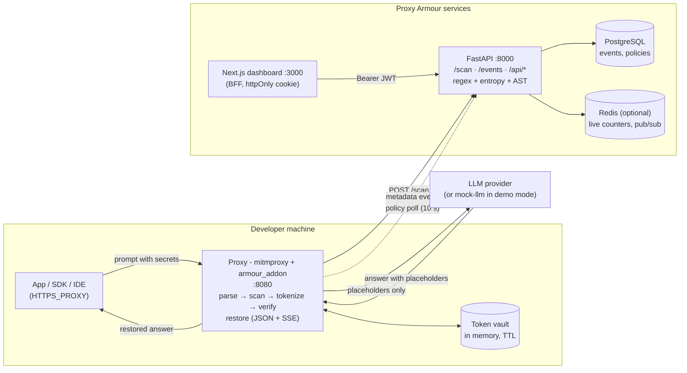

# Proxy Armour

**A data-loss-prevention gateway for LLM APIs.** Proxy Armour sits between developer tools
and LLM providers (OpenAI, Anthropic, Google Gemini, Azure OpenAI, Mistral, Groq). It inspects
every outgoing prompt and, per finding type:

- **tokenizes** secrets and personal data - each value is replaced by a random placeholder
  (`PA_HARDCODED_SECRET_3F9A0C1B`) before the request leaves the machine, and the original is
  **restored locally** in the LLM's answer (JSON and streaming), so the user never notices;
- **blocks** identifiers that must never leave (Aadhaar, PAN, card numbers) with HTTP 403;
- **allows** everything else unchanged.

Detection combines regex rules with checksum validation (Verhoeff, Luhn), Shannon entropy, and a
Python **AST** analysis that finds hard-coded secrets in pasted code. Every request becomes a
**metadata-only** audit event (types, counts, timings - never prompts, values or placeholders)
shown on an admin dashboard. Evaluation results: [eval/results/RESULTS.md](eval/results/RESULTS.md).

## Architecture



| Path | What it is |
|---|---|
| `proxy/` | mitmproxy addon (`armour_addon.py`) and the pure tokenize/restore engine (`tokenization.py`) |
| `app/` | FastAPI service: detectors (`app/detectors/`), policy, audit log, admin API, auth |
| `dashboard/` | Next.js 16 admin console (overview, events, live feed, policies, playground) |
| `mock_llm/` | OpenAI/Anthropic/Gemini-compatible mock for demos and tests |
| `eval/` | Evaluation harness (synthetic corpus, detection / restoration / latency benchmarks) |
| `migrations/` | Alembic schema migrations |
| `scripts/` | `stack.py` (Docker stack CLI), `demo.py`, PowerShell wrapper |
| `CLAUDE.md` | Detailed engineering notes, rules and conventions |

**Privacy invariant:** original values and placeholders never reach logs, the database, Redis,
the dashboard or exception traces (`tests/test_privacy.py` checks every sink). The proxy **fails
closed**: if a request can't be parsed or scanned, it is blocked, never forwarded unscanned.

## Quick start (Docker)

Needs Docker Desktop / Docker Engine with Compose v2, and any Python 3.10+ on the host.

```bash
python scripts/stack.py up      # build + start; first run writes .env.docker with random secrets
python scripts/stack.py seed    # creates the admin login (prints a random password) + default policies
python scripts/stack.py demo    # sample secrets in every provider format → 12/12 checks
```

Windows PowerShell: `.\scripts\armour.ps1 up` (same commands). With make: `make up`, `make seed`, ...

| URL | Service |
|---|---|
| http://localhost:3000 | Dashboard (sign in as `admin` with the password `seed` printed) |
| http://localhost:8000/docs | Admin API (OpenAPI) |
| http://localhost:8080 | The proxy - point `HTTPS_PROXY` here |

All ports are bound to `127.0.0.1`. The Docker stack runs in **demo mode** (LLM traffic goes to
the mock LLM; no API keys needed) - set `demo.enabled: false` in `docker/config.overlay.yaml`
to forward to real providers. Other commands: `logs [service]`, `ps`, `test`, `down [--volumes]`.
After the first `up`, plain `docker compose up -d` works too.

## Manual setup (no Docker)

```powershell
python -m venv venv
.\venv\Scripts\Activate.ps1                  # Linux/macOS: source venv/bin/activate
pip install -r requirements.txt

# optional persistence: PostgreSQL + Redis
copy .env.example .env                       # fill in DATABASE_URL, JWT_SECRET, EVENTS_SHARED_SECRET, ...
python -m app.hash_password                  # -> ADMIN_PASSWORD_HASH='...' for .env
alembic upgrade head

python -m app.main                           # terminal 1 - API + scanner on :8000
python run_proxy.py                          # terminal 2 - proxy on :8080 (CA in ~/.mitmproxy)
python -m mock_llm                           # terminal 3 - only with demo.enabled: true in config.yaml
cd dashboard; copy .env.example .env.local; npm install; npm run dev   # terminal 4 - :3000
```

Without `DATABASE_URL` the proxy and `/scan` still work (policy from `config.yaml`); only the
audit log and dashboard data are disabled. Without Redis everything works; the live feed polls.

## Trusting the Proxy Armour CA

The proxy decrypts HTTPS to inspect prompts, so clients must trust its certificate authority.
Docker: `certs/mitmproxy-ca-cert.pem` (`.cer` for Windows). Manual: `~/.mitmproxy/`.

> The CA private key sits next to the certificate. Anyone with it can impersonate any website to
> machines that trust it - keep it private, use one CA per machine, and remove the trust when done.

**Windows** (current user, no admin needed):
```powershell
certutil -user -addstore Root certs\mitmproxy-ca-cert.cer
# remove:  certutil -user -delstore Root mitmproxy
```

**macOS:**
```bash
sudo security add-trusted-cert -d -p ssl -p basic -k /Library/Keychains/System.keychain certs/mitmproxy-ca-cert.pem
# remove:  sudo security delete-certificate -c mitmproxy /Library/Keychains/System.keychain
```

**Linux** (Debian/Ubuntu; Fedora/RHEL: copy to `/etc/pki/ca-trust/source/anchors/` and run `sudo update-ca-trust`):
```bash
sudo cp certs/mitmproxy-ca-cert.pem /usr/local/share/ca-certificates/mitmproxy.crt
sudo update-ca-certificates
```

## Sending traffic through the proxy

Only POST requests to the hosts in `config.yaml → proxy.llm_hosts` are inspected; other HTTPS
passes through the proxy unchanged (but is still decrypted - see Limitations).

**Python (OpenAI / Anthropic SDKs, httpx, requests).** These use the `certifi` bundle, not the
OS store - point them at a bundle that includes the CA:
```bash
python -c "import certifi, pathlib; pathlib.Path('ca-bundle.pem').write_text(pathlib.Path(certifi.where()).read_text() + pathlib.Path('certs/mitmproxy-ca-cert.pem').read_text())"
export HTTPS_PROXY=http://127.0.0.1:8080 NO_PROXY=localhost,127.0.0.1
export SSL_CERT_FILE=$PWD/ca-bundle.pem          # httpx -> OpenAI / Anthropic SDKs
export REQUESTS_CA_BUNDLE=$PWD/ca-bundle.pem     # requests
python -c "from openai import OpenAI; print(OpenAI().chat.completions.create(model='gpt-4o-mini', messages=[{'role':'user','content':'hi'}]))"
```
(PowerShell: `$env:HTTPS_PROXY="http://127.0.0.1:8080"`, `$env:SSL_CERT_FILE="$PWD\ca-bundle.pem"`.)
Or just: `python test_client.py --ca certs/mitmproxy-ca-cert.pem --stream "mail rahul@acme.com"`.

**Node.js:** `NODE_EXTRA_CA_CERTS=certs/mitmproxy-ca-cert.pem`. Recent Node releases honour
`HTTPS_PROXY` for `fetch` when `NODE_USE_ENV_PROXY=1`; otherwise configure an undici
`EnvHttpProxyAgent`/`ProxyAgent` in the client.

**VS Code** (extensions that call LLM APIs) - trust the CA in the OS store, then in `settings.json`:
```json
{ "http.proxy": "http://127.0.0.1:8080", "http.proxySupport": "override", "http.systemCertificates": true }
```

**Browsers:** Chrome/Edge use the OS trust store and proxy settings (or start Chrome with
`--proxy-server=127.0.0.1:8080`). Firefox has its own store: Settings → Privacy & Security →
Certificates → View Certificates → Authorities → Import, then Settings → Network Settings →
Manual proxy. Note: web chat UIs (chatgpt.com, claude.ai) are not API hosts and are not inspected.

**curl:** `curl -x http://127.0.0.1:8080 --cacert certs/mitmproxy-ca-cert.pem https://api.openai.com/v1/chat/completions ...`

## Demo

See [DEMO.md](DEMO.md) for the 5-minute walkthrough. In short: `stack.py up` → `seed` → open the
dashboard's **Live feed** → `stack.py demo` or `test_client.py` → watch requests appear,
tokenized and restored, with Aadhaar requests blocked; paste text into **Playground** to see
exactly what the LLM would receive.

## Tests and evaluation

```bash
python -m pytest                        # 550+ tests, ~93% line coverage (pytest --cov=app --cov=proxy ...)
python scripts/stack.py test            # same suite in the container, incl. PostgreSQL
cd dashboard && npm run build && npm run lint
python -m eval.run_all                  # ~25 min: detection, restoration, latency -> eval/results/RESULTS.md
```

The evaluation uses only synthetic data: a seeded corpus (`eval/generate.py`, not committed - it
contains realistic fake keys) with a 70/30 dev/test split; nothing is tuned on it. It compares
regex / +entropy / +AST against detect-secrets, measures restoration integrity against an LLM that
damages placeholders, and measures latency with real processes. Stop other heavy programs (and
the Docker stack) before measuring latency.

## Known limitations

- **AST detection is Python-only.** Hard-coded secrets in JavaScript, Go, YAML, `.env` lines etc.
  are caught only if they match a known format or look random (entropy); secrets mentioned only in
  comments or built in f-strings are mostly missed (see RESULTS.md Table D4).
- **Streaming restoration** handles placeholders split across SSE events and network chunks, but:
  compressed event streams are forwarded unrestored (placeholders visible, nothing leaks); an
  OpenAI `n > 1` stream whose choices interleave mid-placeholder may leave it unrestored; LLMs
  that rewrite a placeholder (case, spacing) get it counted as *missing*, not restored.
- **Pinned clients** (apps that pin the provider's certificate) reject the proxy's CA and fail;
  exclude their hosts with mitmproxy's `--set ignore_hosts=...`.
- **The proxy decrypts all HTTPS sent through it**, not only LLM hosts (other hosts are forwarded
  uninspected). To limit interception to LLM APIs, start it with
  `--set allow_hosts='^(api\.openai\.com|api\.anthropic\.com|generativelanguage\.googleapis\.com):443$'`.
- **Non-JSON bodies** (multipart uploads, e.g. audio transcription) are blocked, not scanned.
  Base64 images/files and JSON object keys are not inspected.
- **Throughput:** detection runs in one Python process per scanner; under heavy concurrency with
  large prompts the scanner times out and the proxy fails closed (HTTP 503) - see RESULTS.md
  Table L1. Run more scanner workers/replicas for production loads.
- **Admin:** single admin account; JWTs can't be revoked individually (rotate `JWT_SECRET`).
- Detection quality was measured on synthetic data; real-world precision will be lower.

## Team and module ownership

| Area | Modules | Owner |
|---|---|---|
| Interception & tokenization | `proxy/` | _(name)_ |
| Detection engine | `app/detectors/` | _(name)_ |
| API, policy, audit log, auth | `app/` (excl. detectors), `migrations/` | _(name)_ |
| Dashboard | `dashboard/` | _(name)_ |
| Deployment & demo | `docker-compose.yml`, `docker/`, `scripts/`, `mock_llm/` | _(name)_ |
| Evaluation | `eval/` | _(name)_ |

Capstone project. See [CLAUDE.md](CLAUDE.md) for engineering rules (privacy invariant, fail-closed
paths, configuration, testing conventions).
